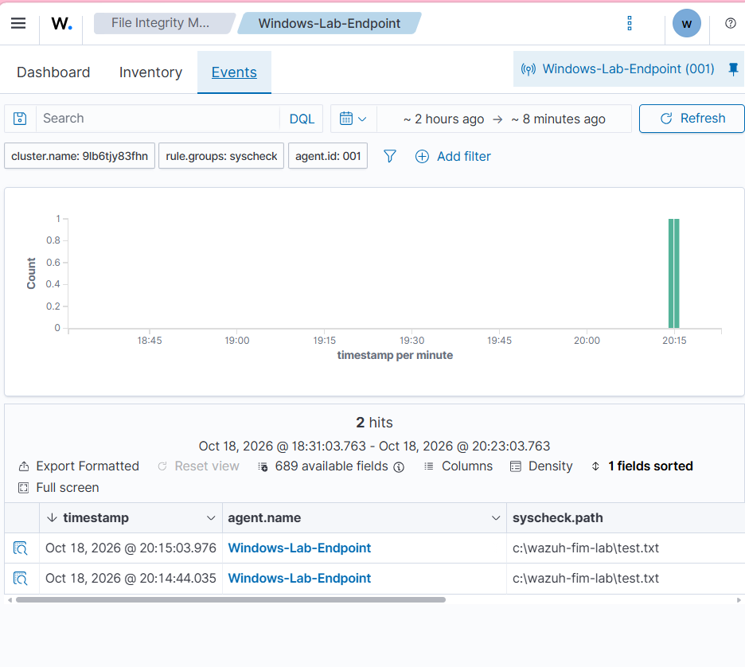
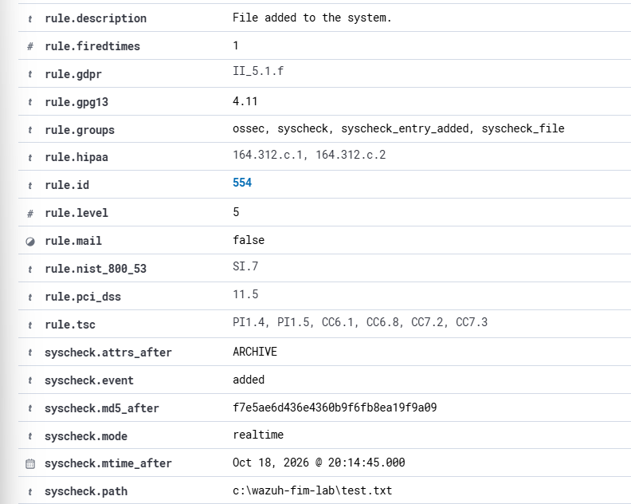
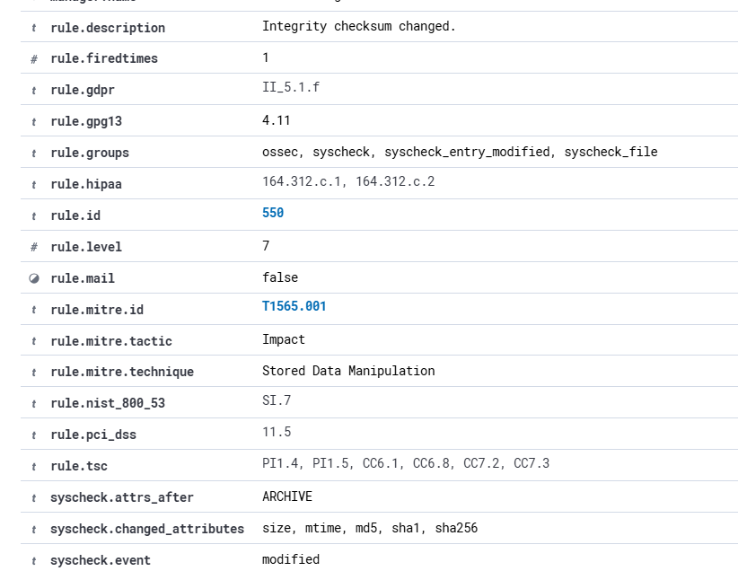

# Wazuh Mini-SOC Lab: Windows Security Monitoring

## Overview

This project documents a beginner-friendly security monitoring lab using **Wazuh Cloud** and a **Windows endpoint agent**. I configured an endpoint to send security telemetry to a cloud-based SIEM, investigated a controlled failed-logon event, and configured File Integrity Monitoring (FIM) to detect changes to a test file.

**Scope:** Authorized testing on my own Windows device. These were controlled lab events, **not confirmed attacks**.

## Tools and environment

- Wazuh Cloud dashboard and Windows Wazuh agent
- Windows 11, Windows Security Event Logs, PowerShell
- Wazuh event exploration, detection rules, and File Integrity Monitoring

## Lab architecture

```text
Windows 11 laptop
   |  Windows security events + FIM telemetry
   v
Wazuh Windows agent (Windows-Lab-Endpoint)
   |  Encrypted agent-to-manager communication
   v
Wazuh Cloud -> Wazuh Dashboard -> Alert investigation
```

The lab used the Wazuh Cloud trial, avoiding the need to host a full SIEM server locally. I validated that the agent was active and security events were appearing in the dashboard.

## Investigation 1 — Failed Windows logon

**Objective:** Generate a controlled authentication failure and investigate the resulting alert.

1. Used Windows `runas` to attempt an interactive logon with an intentionally incorrect password, once.
2. Located the corresponding Wazuh alert and checked its timestamp against the test.
3. Examined Windows event metadata and Wazuh detection rule information.
4. Assessed the event as an **authorized test** rather than evidence of an attack.

| Evidence field | Observed value | Interpretation |
|---|---|---|
| Windows Event ID | `4625` | Failed account logon |
| Logon type | `2` | Interactive logon |
| Status | `0xC000006D` | Authentication failure |
| Substatus | `0xC000006A` | Incorrect password |
| Wazuh rule ID | `60122` | Failed-logon detection rule |
| Wazuh rule level | `5` | Alert severity assigned by Wazuh |

**Assessment:** The alert matched the time and nature of my authorized incorrect-password test. A failed login alone does not establish malicious intent; an analyst should consider frequency, affected accounts, source, and related events before escalating. For this controlled event, I would document the test and close the alert as benign while maintaining routine monitoring.

**Evidence:**


[Full investigation notes](reports/authentication-investigation.md)

## Investigation 2 — File Integrity Monitoring (FIM)

**Objective:** Detect creation and modification of a harmless test file.

1. Verified that Wazuh FIM (`syscheck`) was enabled.
2. Created `C:\Wazuh-FIM-Lab` and configured real-time monitoring for that folder in the agent's `ossec.conf`.
3. Restarted the Wazuh agent to apply the change.
4. Created `test.txt`, then appended a second line to modify it.
5. Examined the resulting Wazuh FIM events for the monitored file.

| Activity | Wazuh finding | Rule ID | Rule level |
|---|---|---|---|
| File created | `File added to the system.` (`syscheck.event: added`) | `554` | `5` |
| File modified | `Integrity checksum changed.` (`syscheck.event: modified`) | `550` | `7` |

For the modification alert, Wazuh reported changes to `size`, `mtime`, `md5`, `sha1`, and `sha256`. These attributes help detect that a monitored file's contents or metadata changed; the alert by itself does not establish malicious tampering.

**Assessment:** Both alerts referenced `C:\Wazuh-FIM-Lab\test.txt` and were consistent with the authorized file operations. I would document and close the controlled test alerts, while investigating unexpected modifications to sensitive files in a production environment.

**Evidence:**







[Full investigation notes](reports/file-integrity-investigation.md)

## Skills practiced

- SIEM agent deployment and troubleshooting
- Windows event log interpretation (Event ID 4625 and logon status codes)
- Wazuh alert triage and severity interpretation
- File Integrity Monitoring configuration and validation
- Evidence collection, privacy-aware screenshot redaction, and investigation documentation

## Limitations and next steps

- All observed test activity was deliberately generated on a personal lab endpoint; no real intrusion was identified.
- This project demonstrates initial detection and investigation, not a full production SOC or a comprehensive incident response exercise.
- Potential future extensions: investigate repeated failed logons, assess Windows security configurations, or compare baseline and modified file hashes across additional monitored paths.

## Privacy

Screenshots have account and device-identifying details redacted. Enrollment credentials, private configuration secrets, and raw unredacted logs are not included.
